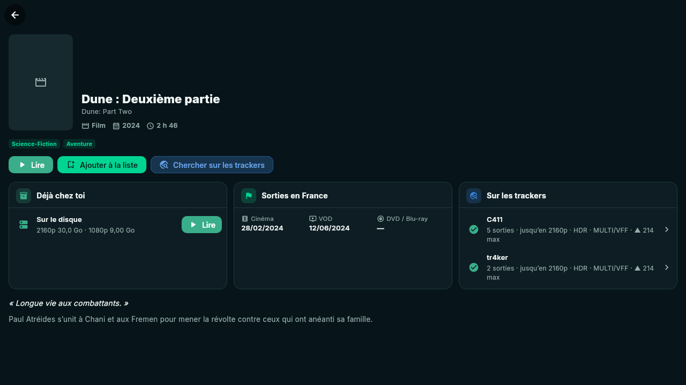

# C411 Remote

> Ton seedbox dans la poche : les sorties des trackers, Transmission, ta liste
> de films à voir et ta vidéothèque, réunis dans une seule application.

C411 Remote est un client **Flutter** multiplateforme (Linux, Android…) qui
parle directement à ton serveur **Transmission**, aux trackers **C411**,
**tr4ker**, **Nostradamus** et **AstraTorrent**, à **TMDB** et au **FTP** de
ta seedbox. Aucun serveur intermédiaire : tout se passe entre l'application et
tes services.

<p align="center">
  
</p>

## Ce qu'elle sait faire

| | |
|---|---|
| 🎬 **Films & séries** | Les tops TMDB (rangées *Découvrir* tournées vers la France) et ta liste de souhaits ; sur chaque affiche, ▶ si tu l'as déjà, ⬇ s'il est sur un tracker. |
| 🌐 **Trackers** | Les sorties de tous les trackers, regroupées par film ou série et illustrées par TMDB ; choisis ta version, ou lis-la si elle est sur le disque. |
| 💾 **Ta vidéothèque** | Ta propre base de films et séries, construite à partir des fichiers de ta seedbox (FTP), reconnue par TMDB, saisons et épisodes compris ; filtre *Sur le disque* dans les deux vues. |
| ▶️ **Lecteur intégré** | Lecture directe du fichier d'origine, sans transcodage (mpv) : pistes audio, sous-titres, reprise là où tu t'étais arrêté. |
| ⬇️ **Transferts** | Tout Transmission : suivi en direct, tris, filtres, actions groupées, détail complet, statistiques, configuration du serveur. |
| 🔁 **Cross-seed** | Repère tes torrents terminés présents sur d'autres trackers et les partage sans rien retélécharger. Relance aussi les sorties **sans seeder** et la liste palliative de C411. |
| 🔔 **Notifications et Salon** | Les notifications de C411 en direct, ton compte (ratio, crédit) et le salon de discussion du site. |

## Démarrage rapide

```sh
# Linux (Debian / Ubuntu / Mint)
sudo apt install clang cmake ninja-build pkg-config libgtk-3-dev \
  libsecret-1-dev libjsoncpp-dev libmpv-dev

flutter pub get
flutter run -d linux
```

Au premier lancement, l'application ouvre les **Réglages** : renseigne au
minimum l'adresse de Transmission et une clé de tracker. Tout le reste est
facultatif et se branche quand tu veux.

## Documentation

La documentation complète est dans [`docs/`](docs/README.md).

**Guide d'utilisation**

1. [Installation](docs/guide/installation.md) — Linux, Android, prérequis
2. [Configuration](docs/guide/configuration.md) — Transmission, trackers, TMDB, FTP, Jellyfin
3. [Films & séries](docs/guide/films-et-series.md) — tops TMDB, souhaits, fiches, lire ou télécharger
4. [Trackers](docs/guide/trackers.md) — toutes les sorties regroupées par titre, versions
5. [Sur le disque et lecture](docs/guide/sur-le-disque.md) — ta vidéothèque et le lecteur intégré
6. [Transferts](docs/guide/transferts.md) — Transmission, statistiques, serveur
7. [Cross-seed et sans seeder](docs/guide/cross-seed.md) — partager plus, relancer les morts
8. [Notifications et Salon](docs/guide/notifications.md) — C411 en direct
9. [Dépannage](docs/guide/depannage.md) — questions fréquentes

**Pour les développeurs**

- [Architecture](docs/dev/architecture.md) — organisation du code, état, flux de données
- [Notes sur les API](docs/dev/api.md) — C411, Torznab, AstraTorrent, TMDB, Jellyfin, Transmission, FTP
- [Interface et performances](docs/dev/interface.md) — thème, composants, choix pour rester fluide
- [Tests](docs/dev/tests.md) — ce qui est vérifié et comment

## Plateformes

| Plateforme | État |
|---|---|
| Linux | utilisée au quotidien |
| Android | APK compilé (API 24 → 36), mise en page téléphone vérifiée |
| iOS, Windows, macOS | projet généré, non testé |
| Web | non prise en charge (ni Transmission ni les trackers n'autorisent les requêtes d'un navigateur, CORS) |

## Vie privée

Les identifiants (Transmission, clés et passkeys des trackers, cookie de
session, FTP, TMDB, Jellyfin) sont rangés dans le **trousseau du système**
(libsecret, Keychain, Keystore). Ils ne quittent l'appareil que pour joindre
le service auquel ils appartiennent.

## Licences

Code de l'application : privé. Police [Inter](https://rsms.me/inter/) sous
licence OFL (`assets/fonts/`). Copie corrigée de `media_kit_video` sous
licence MIT ([`third_party/media_kit_video`](third_party/media_kit_video/C411-PATCH.md)).
Données de films et séries fournies par [TMDB](https://www.themoviedb.org/)
(l'application n'est ni approuvée ni certifiée par TMDB).
