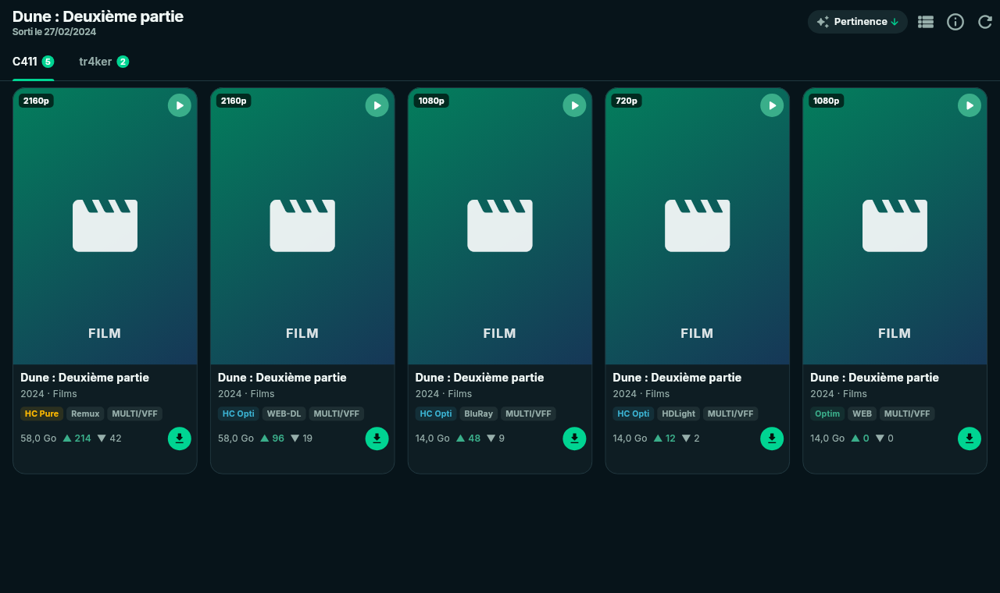
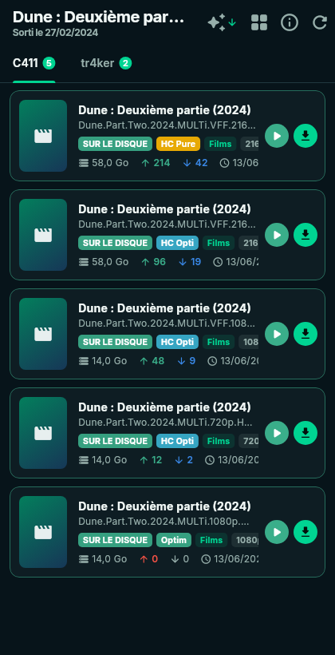

# Souhaits

[← Sommaire](../README.md)

L'onglet **Souhaits** sert à suivre les films et séries que tu attends, à en
découvrir d'autres, et à les trouver sur les trackers. Il demande une
[clé TMDB](configuration.md#tmdb).

Trois boutons en haut de la page :

| Bouton | Contenu |
|---|---|
| **Découvrir** | des rangées thématiques tournées vers les sorties françaises |
| **Ma liste** | tes souhaits, avec leur nombre |
| **Sur le disque** | ta vidéothèque (voir [Sur le disque](sur-le-disque.md)) |

La barre de recherche interroge TMDB (films et séries) ; une recherche en cours
s'affiche à la place des trois vues.

## Découvrir

Rangées défilant horizontalement, inspirées de Seerr :

- Tendances de la semaine
- Au cinéma en France · Bientôt au cinéma en France
- Récemment sortis en VOD en France · Films français à venir
- Films populaires
- Séries tendance · Séries en cours de diffusion · Séries françaises
- Une rangée par **genre**

« Tout voir » ouvre la liste complète d'une rangée, chargée au fil du
défilement.

## Ma liste

Chaque souhait affiche son affiche, son type, sa date la plus utile et ce que
tu possèdes déjà :

- **Date** : pour un film, la sortie en salles en France si elle est à venir,
  sinon la VOD française, à défaut la date mondiale. Les dates françaises sont
  relues une fois par jour.
- **Pastilles** : *Sur le disque*, *Dans Jellyfin*, *Téléchargé*,
  *En cours 42 %*.

## Fiche d'un titre

  

- Image de fond, affiche, titre original, durée, note, genres.
- Boutons : **Lire** / **Épisodes** (si tu l'as déjà), **Ajouter à la liste**,
  **Chercher sur les trackers**, **Bande-annonce**.
- Trois encadrés, côte à côte sur PC :
  - **Déjà chez toi** : fichiers de ta base (versions, tailles), élément
    Jellyfin, torrents dans Transmission (téléchargés ou en cours, avec leur
    progression) ;
  - **Sorties en France** (films) : cinéma, VOD, DVD / Blu-ray ;
  - **Sur les trackers** : pour chacun, le nombre de sorties, la meilleure
    qualité, HDR, Atmos, langues, seeders max, freeleech. Lancée d'office
    pour un titre sorti, à la demande pour un titre à venir.
- Accroche, synopsis, réalisation, scénario.
- Pour une série : **ses saisons et épisodes sur le disque**, directement dans
  la fiche.
- Distribution et recommandations, en rangées.

## Chercher sur les trackers

**Chercher sur les trackers** (ou un clic sur une ligne de « Sur les
trackers ») ouvre les résultats, **un onglet par tracker** avec le nombre de
résultats.

  

- La recherche essaie le titre français et le titre original, et écarte les
  sorties d'un autre titre ou d'une autre année.
- **Tri** (menu en haut) :

  | Tri | Effet |
  |---|---|
  | Pertinence | ordre du tracker |
  | Qualité | groupes 2160p, 1080p, 720p… avec intertitres |
  | Profil C411 | groupes par profil, avec leur description |
  | Taille, Seeders, Date | ordre simple |

- **Grille ou liste** : même bouton que dans les Sorties.

  

