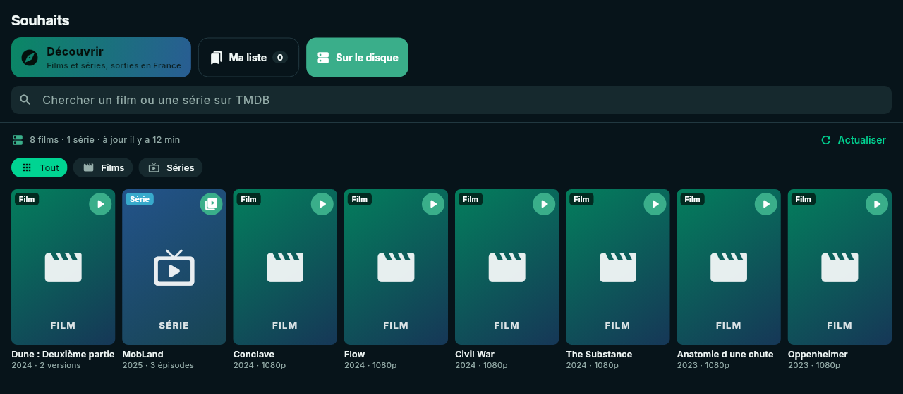

# Sur le disque et lecture

[← Sommaire](../README.md)

**Sur le disque** est ta propre vidéothèque : l'application parcourt les
fichiers de ta seedbox, reconnaît les films et les épisodes, les illustre avec
TMDB, et les lit directement — sans Jellyfin, sans transcodage.

  

Il faut avoir renseigné le [serveur de fichiers (FTP)](configuration.md#serveur-de-fichiers-ftp).
La vue est dans **Souhaits → Sur le disque**.

## D'où viennent les fichiers

1. **Les torrents terminés de Transmission.** Transmission connaît leurs
   chemins sur le serveur (`/APPBOX_DATA/apps/…/torrents/completed/…`), le FTP
   les montre sous un autre chemin (`/torrents/completed/…`). L'application
   trouve seule la correspondance au premier parcours, puis la vérifie à
   chaque fois.
2. **Les dossiers que tu as indiqués** dans les Réglages, parcourus en
   profondeur.

Sont retenus les fichiers vidéo (`mkv`, `mp4`, `avi`, `ts`, `m2ts`, `webm`,
`mov`…) ; les extraits (*sample*) et les bonus (*Extras*, *Featurettes*…) sont
ignorés.

## Comment un fichier est reconnu

Le nom du fichier **et** celui de ses dossiers sont analysés :

| Chemin | Reconnu comme |
|---|---|
| `Dune.Part.Two.2024.MULTi.2160p.WEB.H265-GRP.mkv` | film *Dune Part Two*, 2024, 2160p |
| `Le.Comte.2024.1080p-GRP/grp-lcdmc-1080p.mkv` | film — le dossier, mieux nommé, l'emporte |
| `MobLand.2025.S01.MULTI-ZAKARI/MobLand (2025) - S01E04 - Rat Trap.mkv` | série *MobLand*, saison 1, épisode 4 |
| `Séries/Crystal Lake (2025)/Season 01/S01E04.mkv` | série *Crystal Lake* (titre pris au dossier) |
| `Show.Name.2x05.HDTV.avi` | série, saison 2, épisode 5 |

Chaque titre est ensuite rattaché à sa fiche **TMDB** (affiche, titre français,
résumé, titres des épisodes). Deux noms différents pour la même fiche
(« Dune Part Two » et « Dune Deuxième Partie ») sont regroupés.

## Quand la base se met à jour

- au lancement, si le dernier parcours date de plus d'une heure ;
- dès que tu changes les réglages FTP ou les dossiers ;
- avec le bouton **Actualiser** de la vue.

La base est rangée sur l'appareil : elle s'affiche tout de suite, même hors
ligne. La ligne d'état indique ce qui se passe (« Dossier /Films… »,
« Fiches TMDB 3/12 ») ou le nombre de films et séries, et l'heure du dernier
parcours.

## Où elle apparaît

- **Sur le disque** : grille filtrable (Tout / Films / Séries), les derniers
  arrivés d'abord. Un clic ouvre la fiche complète du titre ; le bouton rond
  lance la lecture (ou ouvre les épisodes).
- **Fiche d'un titre** : bouton **Lire** / **Épisodes**, encadré « Déjà chez
  toi », et pour une série ses saisons et épisodes.
- **Sorties** : pastille **SUR LE DISQUE** et bouton ▶ sur les sorties que tu
  as déjà (même torrent, même nom de fichier ou de dossier, ou même titre et
  année).

## Séries : saisons et épisodes

Une pastille par saison, avec le nombre d'épisodes ; la saison affichée est
celle d'un épisode entamé, sinon la dernière. Chaque épisode montre sa
vignette, son titre et son résumé TMDB, sa durée, sa date et ses versions. Un
clic ouvre le détail ; le bouton ▶ le lance. Les épisodes entamés portent la
mention **ENTAMÉ**.

## Plusieurs versions

Si un film (ou un épisode) existe en plusieurs fichiers, l'application demande
**quelle version** lire, la meilleure d'abord (résolution, puis taille), avec
source, codec et taille, et signale celles dont la lecture est entamée.

## Le lecteur intégré

Basé sur **mpv** (media_kit), il lit le fichier d'origine sans transcodage :
quasiment tous les formats (MKV, HEVC, AV1, HDR, DTS, TrueHD…) passent tels
quels.

- Commandes standard : barre de progression, volume, plein écran ; sur PC,
  raccourcis clavier (espace, flèches, F…).
- Menus **pistes audio** et **sous-titres**.
- **Reprise** : la position est enregistrée toutes les 10 s et retrouvée à la
  prochaine lecture (oubliée une fois la vidéo presque finie).
- **Statistiques** (ⓘ) : décodage matériel, codec, résolution, HDR, images
  perdues — utile pour comprendre une lecture saccadée.

### Comment il lit un fichier du FTP

mpv ne sait pas lire en FTPS. L'application ouvre donc un petit **relais HTTP
local**, sur `127.0.0.1` uniquement : le lecteur lui demande des morceaux du
fichier (requêtes `Range`), le relais les lit sur le FTP à partir de la
position voulue. L'avance rapide fonctionne ; chaque saut ouvre une nouvelle
connexion FTP, ce qui peut prendre une seconde.

## Et Jellyfin ?

Jellyfin reste possible en secours : si un titre n'est pas dans la base mais
dans ta bibliothèque Jellyfin, les boutons Lire et Épisodes passent par lui.
Les bibliothèques mixtes (films et séries mélangés, dossiers nommés comme la
release) sont prises en charge, y compris une sortie par saison.
